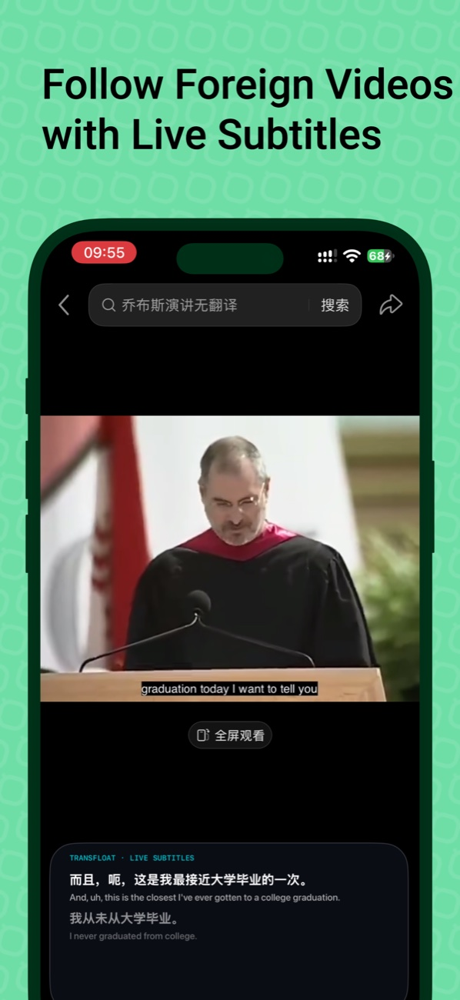
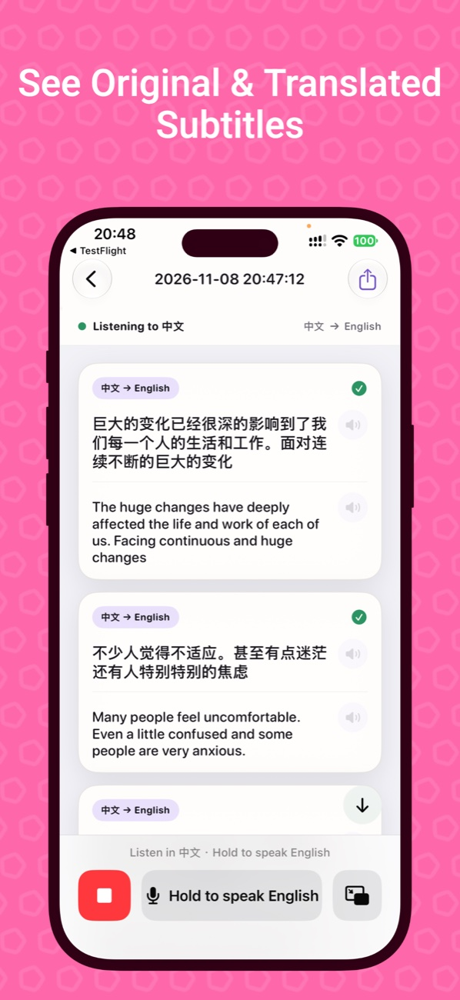
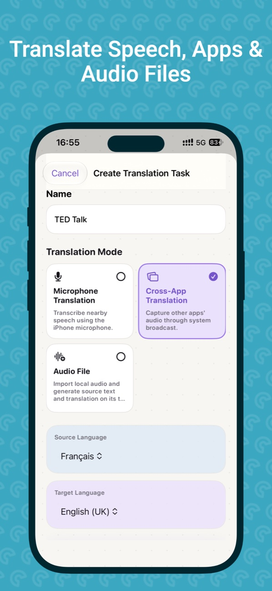
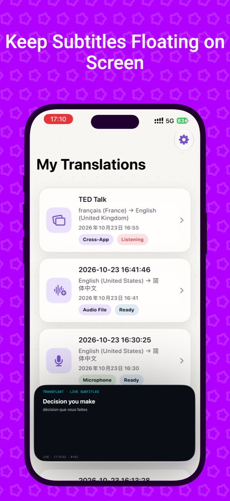
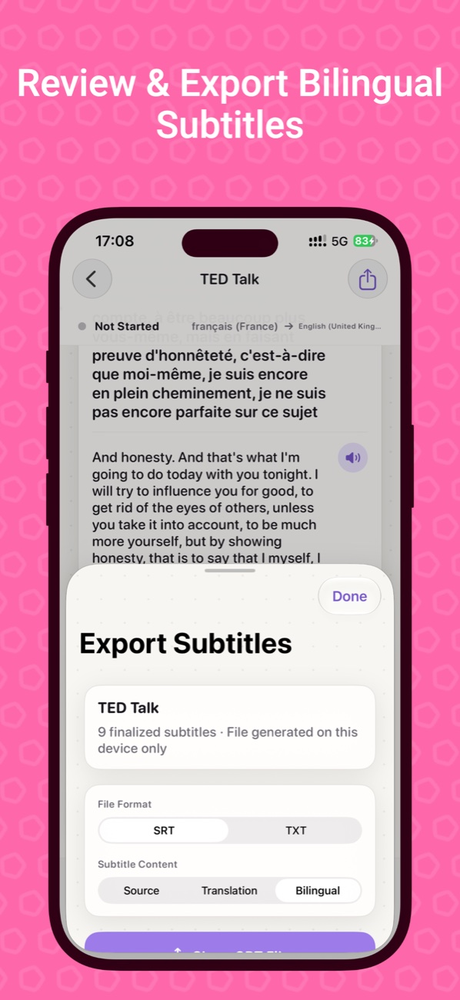
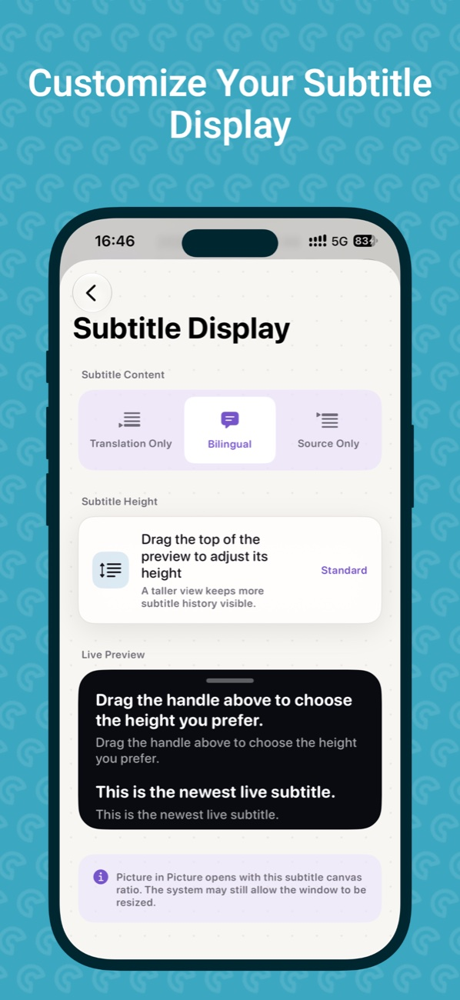

  

<h1 align="center">TransFloat</h1>

<strong>Live bilingual subtitles for what you hear.</strong> Translate speech, supported app audio, and recordings on iPhone.

  <strong>English</strong> · <a href="README.zh-CN.md">简体中文</a> 
  <a href="https://apps.apple.com/cn/app/transfloat-ai-live-translator/id6823429655">App Store</a> · <a href="https://www.qinfu-cloud.cn/TransFloat/">Product website</a> · <a href="docs/en/faq.md">FAQ</a>

Follow a conversation, lecture, or video in another language. TransFloat shows the original speech and the translation together, so you can follow the meaning and refer back to the original words.

## TransFloat 2.0 screenshots

Select a screenshot to enlarge it.

  
  
  

  
  
  

[English](assets/screenshots/en/) · [简体中文](assets/screenshots/zh-CN/) · [繁體中文](assets/screenshots/zh-TW/) · [日本語](assets/screenshots/ja/) · [한국어](assets/screenshots/ko/) · [Français](assets/screenshots/fr/)

## What you can do

- **Microphone:** Translate speech around you into live subtitles.
- **Cross-app audio · Pro:** Start an iOS system broadcast to translate audio from supported apps. Some apps or protected content may not provide usable audio.
- **Audio files · Pro:** Import a recording and review the original and translated subtitles as a timeline.
- **Floating subtitles · Pro:** Use Picture in Picture to keep captions visible while switching apps.
- **History and export:** Reopen saved translations and export subtitles as SRT or TXT. Choose bilingual, original-only, or translated text.

## Help

[Frequently asked questions](docs/en/faq.md) · [Email support](mailto:support@qinfu-cloud.cn) · [Official support](https://www.qinfu-cloud.cn/TransFloat/support/) · [Privacy policy](https://www.qinfu-cloud.cn/TransFloat/privacy/)

For help, include your TransFloat version, iOS version, device model, and the steps to reproduce the issue.

---

Made by **Qinfu Tech · Shanghai Qinfu Information Technology Co., Ltd.**

This repository contains official product materials and help. App source code and product assets are not licensed for reuse here.
