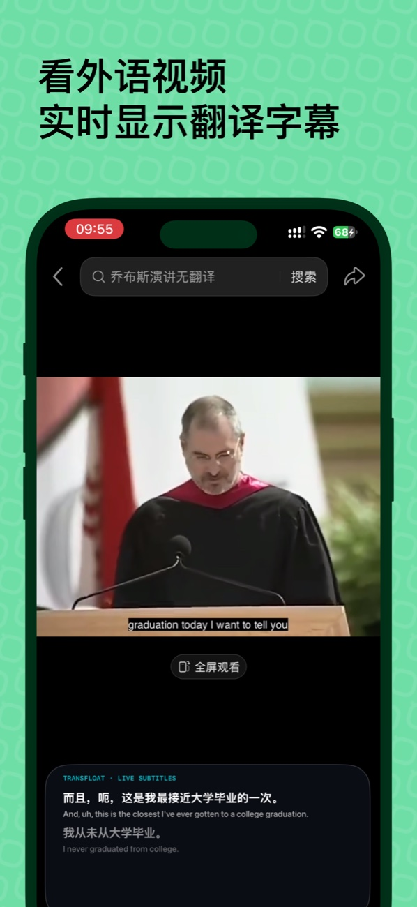
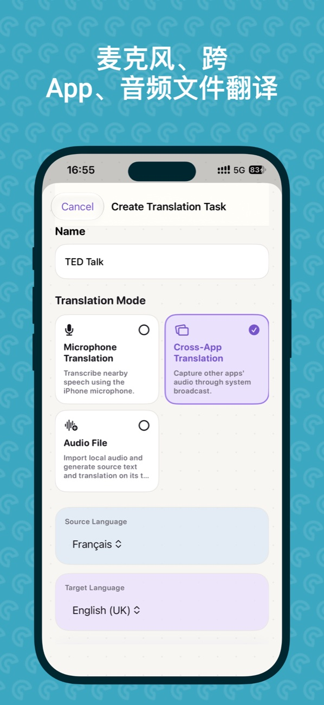
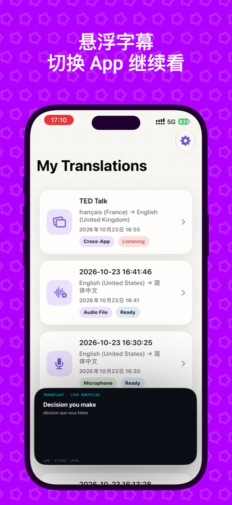
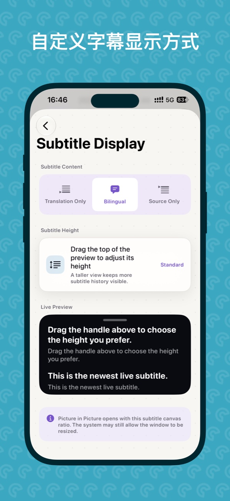

  

<h1 align="center">TransFloat</h1>

<strong>听到哪里，字幕就翻译到哪里。</strong> 在 iPhone 上翻译现场语音、支持的 App 音频和录音。

  <a href="README.md">English</a> · <strong>简体中文</strong> 
  <a href="https://apps.apple.com/cn/app/transfloat-ai-live-translator/id6823429655">App Store</a> · <a href="https://www.qinfu-cloud.cn/TransFloat/">产品官网</a> · <a href="docs/zh-CN/faq.md">常见问题</a>

听外语对话、讲座或视频时，TransFloat 可以同时显示原文和译文。跟上内容的同时，也能回看原话。

## TransFloat 2.0 截图

点击截图可查看大图。

  
  
  

  
  
  

[English](assets/screenshots/en/) · [简体中文](assets/screenshots/zh-CN/) · [繁體中文](assets/screenshots/zh-TW/) · [日本語](assets/screenshots/ja/) · [한국어](assets/screenshots/ko/) · [Français](assets/screenshots/fr/)

## 你可以用它做什么

- **麦克风翻译：** 将身边的语音转成实时字幕。
- **跨应用音频翻译 · Pro：** 启动 iOS 系统广播，翻译支持的 App 提供的音频。部分 App 或受保护的内容可能无法提供可用音频。
- **音频文件翻译 · Pro：** 导入录音，按时间回看原文与译文。
- **悬浮字幕 · Pro：** 通过画中画在切换 App 时继续查看字幕。
- **历史与导出：** 回看已保存的翻译，导出 SRT 或 TXT，可选择双语、仅原文或仅译文。

## 帮助

[常见问题](docs/zh-CN/faq.md) · [邮件支持](mailto:support@qinfu-cloud.cn) · [官方支持](https://www.qinfu-cloud.cn/TransFloat/support/) · [隐私政策](https://www.qinfu-cloud.cn/TransFloat/privacy/)

反馈问题时，请附上 TransFloat 版本、iOS 版本、机型和复现步骤。

---

由 **上海秦伏信息科技有限公司（Qinfu Tech）** 开发。

本仓库用于产品展示与帮助。App 源码未在此发布，产品素材未授予复用许可。
